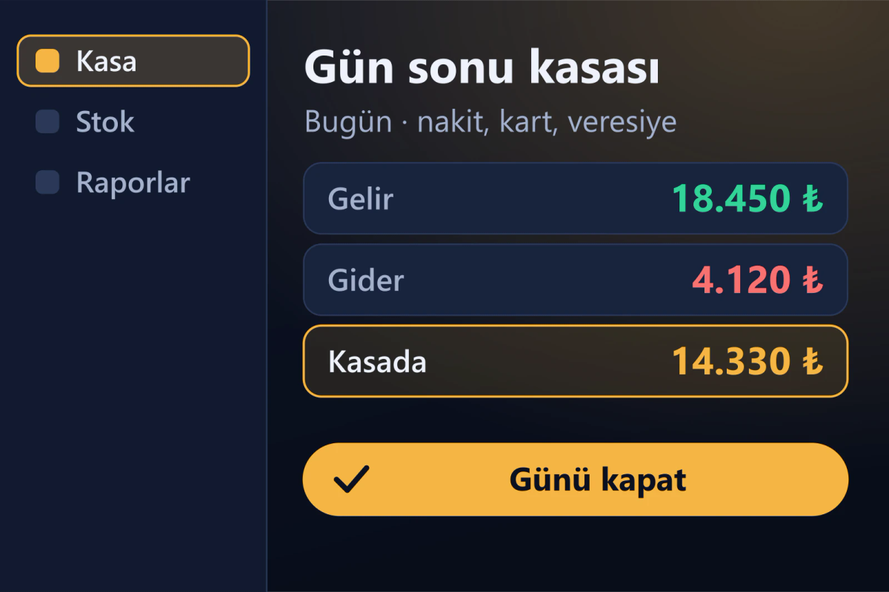

<div align="center">


# RVLX Kasa

**Her işletme için kasa, fatura ve raf yönetimi — muhasebe bilgisi gerekmez.**

<a href="https://www.arvelx.com/urunler/rvlx-kasa"></a> <a href="https://github.com/tlgtrzi-code/RVLX-Kasa/releases/latest"></a> 

</div>

---

<div align="center">

</div>

Esnaf ve küçük işletmeler için günlük kasa takibi. Gelir gideri girin, gün sonunda kapanışı alın; faturalarınızı, komisyonlarınızı ve rafınızı aynı yerden yönetin.

## ✨ Neler yapar

- 🌙 **Kasa ve gün sonu** — birden fazla kasa, tek ekrandan gelir gider ve sayımla farkı gösteren günlük kapanış.
- 📊 **Raporlar** — Premium Rapor PRO Executive Ledger ve parçaları açıp kapatabildiğiniz **RVLX Rapor Modüler**.
- 🧾 **E-Arşiv** — satış PDF'lerinizden GİB UBL-TR 1.2.1 uyumlu, doğrulanmış XML; KDV oranı PDF'ten okunur.
- 📑 **Faturalar ve komisyon takibi** — Excel gibi tablo, yazdıkça tamamlanan firma ve cari adları, Tab ile hızlı giriş.
- 🔎 **Raf yapay zekâ araması** — şikâyeti yazın, stokta işe yarayanı birkaç saniyede bulsun; benzer ürünler tek tıkla.
- 📱 **Mobil bağlantı** — telefon karekod ve PIN ile bağlanır, raf ve komisyon kayıtları telefondan da girilir.
- 🏪 **Her esnafa uygun** — ilaç, takviye, gıda, kozmetik, temizlik, hırdavat… raf ürün türünü tanır.

## 🎁 Ücretsiz deneyin

Kurulumdan sonra ARVELX hesabınızla **3 gün ücretsiz** kullanın. Lisans süreleri ve fiyatlar: **[arvelx.com/fiyatlandirma](https://www.arvelx.com/fiyatlandirma)**

## 📦 İndirme ve doğrulama

1. **[Releases](https://github.com/tlgtrzi-code/RVLX-Kasa/releases/latest)** bölümünden `RVLX_Kasa_Setup.exe` dosyasını indirin.
2. Dosyayı sürümle gelen `SHA256SUMS.txt` ile doğrulayın:

   ```powershell
   Get-FileHash .\RVLX_Kasa_Setup.exe -Algorithm SHA256
   ```

   Çıkan değer `SHA256SUMS.txt` içindekiyle aynı olmalıdır.
3. Kurun. Uygulama sonraki sürümleri kendisi bulur; verileriniz (`%APPDATA%\RVLX Kasa`) korunur.

Burada her zaman son iki sürüm durur; en yeni sürümün notu önceki sürümlerde gelenleri de özetler.

## 🧩 Diğer ARVELX ürünleri

| | Ürün | |
|---|---|---|
| 🤖 | **RVLX AI** — modeller tartışır, hakemler karar verir (Windows) | [Sürümler](https://github.com/tlgtrzi-code/RVLX-AI) · [Ürün sayfası](https://www.arvelx.com/urunler/rvlx-ai) |
| 📱 | **RVLX Media** — tarayıcı, indirici ve müzik çalar (Android) | [Sürümler](https://github.com/tlgtrzi-code/RVLX-Media) · [Ürün sayfası](https://www.arvelx.com/urunler/rvlx-media) |
| 💻 | **RVLX Media Desktop** — hızlı indirme yöneticisi (Windows) | [Sürümler](https://github.com/tlgtrzi-code/RVLX-Media-Desktop) · [Ürün sayfası](https://www.arvelx.com/urunler/RVLX-Media-Desktop) |

## ℹ️ Bu depo hakkında

Bu depo RVLX Kasa'nın **genel dağıtım** noktasıdır: kurulum dosyası, sürüm notları ve doğrulama değerleri **Releases** bölümünde yayınlanır. Kaynak kod burada bulunmaz.

Destek: **[arvelx.com/iletisim](https://www.arvelx.com/iletisim)** · [Facebook](https://www.facebook.com/Arvelx/) · [Instagram](https://www.instagram.com/arvelxai/) · [YouTube](https://www.youtube.com/@Arvelx-RVLX)

<div align="center">
<br>
<a href="https://www.arvelx.com"></a>
<br><sub>© ARVELX · RVLX ürün ailesi</sub>
</div>
